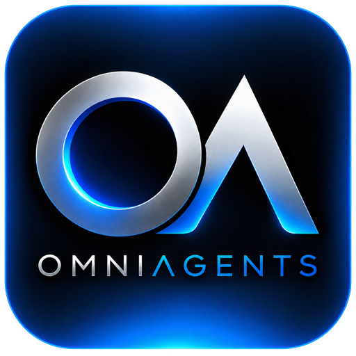

# OmniAgents

Il plugin collega ChatGPT desktop alla tua installazione OmniAgents e agli strumenti delle fonti che hai autorizzato.

[Sito](https://omniagents.it/) · [Assistenza](mailto:info@omniagents.it)

## Stato della versione

**Anteprima 0.1.0.** Il catalogo GitHub e il pacchetto sono distribuibili. Il primo collegamento richiede una versione OmniAgents che supporti il ritorno OAuth desktop. Le versioni che accettano soltanto il ritorno OAuth di ChatGPT web non sono compatibili: il plugin rifiuta il collegamento e non aggira questa limitazione.

Il completamento dell'installazione non dimostra che l'autorizzazione o le operazioni siano riuscite. Il flusso completo in due clic è ancora da verificare nell'app.

## Aggiungi il marketplace

In ChatGPT desktop: **Plugin → Aggiungi → Aggiungi marketplace di plugin**.

- Origine: `https://github.com/Grooves76/omniagents-plugin`
- Riferimento Git: `main`
- Percorsi selettivi: lascia vuoto

Scegli **OmniAgents** nel marketplace. Il repository è pubblico: per scaricarlo tramite HTTPS non serve un account GitHub.

Su macOS, lo script `scripts/open-plugin.command` registra questo marketplace con il CLI ufficiale incluso in ChatGPT e apre la schermata di installazione. È il punto di ingresso predisposto per il pulsante **Collega**; questa versione del repository non modifica automaticamente l'app OmniAgents installata.

## Funzioni e strumenti

Il plugin inoltra le richieste al Core della tua installazione: non contiene una copia ridotta degli strumenti né un catalogo statico di risposte. Il catalogo Personal verificato nel sorgente comprende **127 strumenti con autorizzazione operativa OAuth**, oppure **125 senza i due strumenti di conferma operativa** (`hub_write_decide` e `hub_confirmation_policy_prepare`). Il numero effettivo viene letto dal server e può cambiare con la versione e i permessi.

Le funzioni delle fonti richiedono i relativi account collegati e autorizzati. La scoperta degli strumenti non dimostra il funzionamento di ogni provider.

## Collegamento personale

Ogni utente collega la propria installazione. L'indirizzo viene individuato sul suo computer; il repository non contiene indirizzi di installazioni personali, credenziali o identificativi di plugin cloud. L'autorizzazione usa OAuth con PKCE e le credenziali sono conservate nel Portachiavi macOS.

Collegare ChatGPT non cambia il modello attivo. Se Claude è attivo, il server conserva ChatGPT in attesa e può rispondere `AI_NOT_ACTIVE` alle operazioni; il cambio dell'AI resta una scelta nell'app.

Questa anteprima riguarda il client desktop locale su macOS. La pubblicazione su GitHub non installa il plugin nel normale ChatGPT web o sui dispositivi mobili e non equivale alla pubblicazione nel catalogo pubblico OpenAI.

## Sviluppo

Il marketplace è in `.agents/plugins/marketplace.json`; il pacchetto è in `plugins/omniagents`. Il manifest portabile e quello di compatibilità desktop condividono nome, versione, sito, contatti e logo.

I test del bridge sono in `plugins/omniagents/tests`. Non utilizzare credenziali reali nei test o aggiungerle al repository.

## OmniAgents Business

Il marketplace include anche **[OmniAgents Business](plugins/omniagents-business/README.md)** (`omniagents-business@omniagents`, versione `0.1.0`), con logo Business e contorno fluorescente azzurro. Seleziona questa voce per collegare l’installazione Business. Endpoint e autorizzazione sono separati dal plugin Personal; il collegamento conserva l’AI attiva scelta nell’app. Il catalogo effettivo Business viene letto dal suo Core dopo OAuth e non è dedotto dal conteggio Personal.
